# AI 代理（AI Agent）運作原理圖解

> 一句話版本：**AI 代理 = 大型語言模型（LLM）+ 一組工具 + 一個不斷重複「思考 → 行動 → 觀察」的迴圈。**
>
> 本文整理自 Anthropic 官方工程文章《Building Effective Agents》、ReAct 論文（Yao et al., 2022）以及 2025–2026 年主流實作教學，並以繁體中文、Mermaid 圖解方式說明。所有圖片都是 Mermaid 原始碼，在 GitHub、VS Code（安裝 Markdown Preview Mermaid Support）、Obsidian、Typora 中都能直接渲染。

---

## 目錄

1. [什麼是 AI 代理？和聊天機器人差在哪](#1-什麼是-ai-代理和聊天機器人差在哪)
2. [核心四元件](#2-核心四元件)
3. [代理迴圈怎麼跑：ReAct](#3-代理迴圈怎麼跑react)
4. [訊息如何在 API 層流動](#4-訊息如何在-api-層流動)
5. [常見設計模式](#5-常見設計模式)
6. [工具設計是成敗關鍵（ACI）](#6-工具設計是成敗關鍵aci)
7. [安全與可靠性](#7-安全與可靠性)
8. [多代理與進階主題](#8-多代理與進階主題)
9. [參考資料](#9-參考資料)

---

## 1. 什麼是 AI 代理？和聊天機器人差在哪

傳統聊天機器人是「一問一答」：你丟一句話進去，模型吐一段文字出來，結束。它不能查資料、不能跑程式、不能自己決定下一步。

AI 代理不同。你給它一個**目標**，它會自己決定要做哪些事、用哪些工具、做到什麼時候算完成。模型不再只是「回答」，而是「行動」。

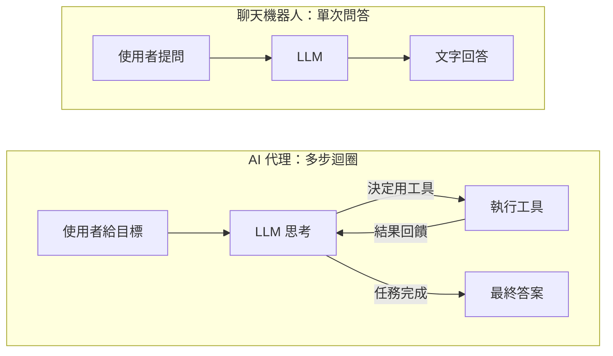

### Anthropic 的定義：Workflow vs Agent

Anthropic 把這類系統統稱為「代理式系統（agentic systems）」，再細分成兩種：

| 類型 | 誰決定下一步？ | 特性 | 適合場景 |
|---|---|---|---|
| **Workflow（工作流）** | 你寫的程式碼 | 路徑預先定義好，LLM 只負責其中幾個步驟 | 步驟可預測、需要穩定可控 |
| **Agent（代理）** | LLM 自己 | 模型動態決定要呼叫哪些工具、做幾步 | 開放式問題、步數無法事先知道 |

Anthropic 的建議很明確：**先用最簡單的方案**。單次 LLM 呼叫能解決就不要用 workflow，workflow 能解決就不要用 agent。代理的自主性越高，成本、延遲與錯誤累積的風險也越高。

---

## 2. 核心四元件

不管用什麼框架，一個代理拆開來都是這四塊：

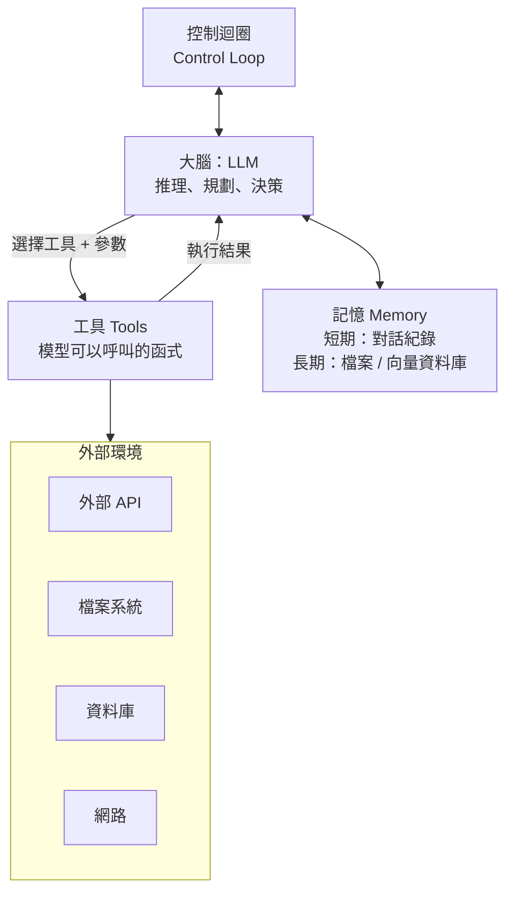

| 元件 | 做什麼 | 白話比喻 |
|---|---|---|
| **LLM（大腦）** | 讀取目前所有資訊，決定下一步：直接回答，還是呼叫某個工具 | 一位會思考的助理 |
| **工具（手腳）** | 普通的函式：查天氣、算數、讀檔、呼叫 API。模型**只能提議**要呼叫哪個工具，真正執行的是你的程式 | 助理可以使用的計算機、電話、檔案櫃 |
| **記憶** | 短期：這次對話的所有訊息（存在 context window 裡）。長期：跨次對話保留的筆記、向量資料庫 | 助理的便條紙與檔案櫃 |
| **控制迴圈** | 反覆「呼叫模型 → 執行工具 → 把結果塞回去」，並決定何時停止 | 管理助理「做到什麼時候算完」的規則 |

> **關鍵觀念**：模型本身**沒有**執行能力。它只會輸出一段結構化的「我想呼叫 `calculate`，參數是 `{"expression": "123*45"}`」。真正去跑函式、拿結果的是你寫的迴圈。這就是為什麼安全管控要放在迴圈這一層，而不是模型裡。

---

## 3. 代理迴圈怎麼跑：ReAct

2022 年 Yao 等人提出的 **ReAct（Reasoning + Acting）** 是目前幾乎所有代理的基礎模式。每一輪包含三個動作：

1. **Thought（思考）**：模型根據目前資訊，想下一步該做什麼。
2. **Action（行動）**：模型決定呼叫某個工具，並給出參數。
3. **Observation（觀察）**：工具執行結果回到模型眼前，成為下一輪思考的依據。

重複直到模型認為任務完成，或是達到安全上限。

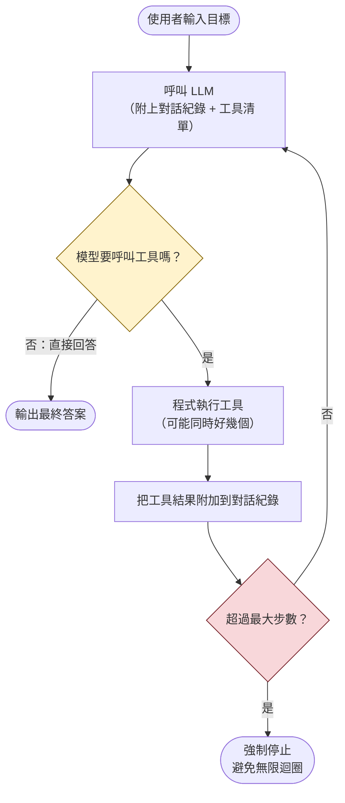

用時序圖看同一件事，就能看出「誰在跟誰講話」：

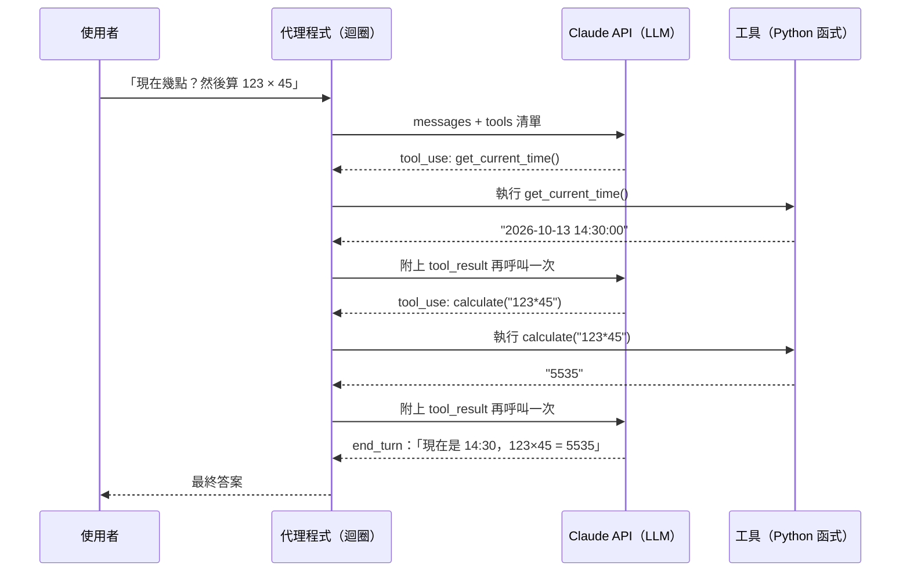

注意模型被呼叫了**三次**。每一次都把完整的對話紀錄（包含先前的工具結果）送過去，模型是「無狀態」的，記憶完全靠你把歷史重送回去。

---

## 4. 訊息如何在 API 層流動

以 Claude API 為例（其他供應商的 function calling 概念相同），對話是一個 `messages` 陣列，角色在 `user` 與 `assistant` 之間交替。工具呼叫靠兩種特殊的內容區塊（content block）完成：

- **`tool_use`**：出現在 assistant 訊息裡，表示「模型想呼叫工具」，帶有 `id`、`name`、`input`。
- **`tool_result`**：出現在 user 訊息裡，表示「工具跑完了，結果在這」，必須帶上對應的 `tool_use_id`。

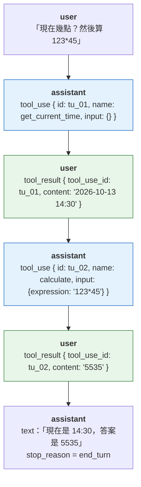

### `stop_reason`：迴圈靠它決定要不要繼續

每次 API 回應都帶有 `stop_reason`，這是迴圈的方向盤：

| `stop_reason` | 意思 | 迴圈該做什麼 |
|---|---|---|
| `tool_use` | 模型想呼叫工具 | 執行工具，把結果附回去，再呼叫一次 |
| `end_turn` | 模型講完了 | 取出文字，結束迴圈 |
| `max_tokens` | 回答太長被截斷 | 提高上限或縮小任務 |
| `refusal` | 安全政策拒絕 | 結束並告知使用者 |

### 三條鐵則

1. assistant 回應的 `content` 要**原封不動**放回 messages（包含 `tool_use` 區塊），不能只留文字。
2. 每個 `tool_result` 的 `tool_use_id` 要對上 `tool_use` 的 `id`。
3. 模型若一次要求多個工具（平行呼叫），所有 `tool_result` 要放在**同一則** user 訊息裡回傳。拆成多則會讓模型以後不敢再平行呼叫。

---

## 5. 常見設計模式

Anthropic 整理出五種 workflow 模式與一種自主代理。它們像樂高積木，可以組合使用。

### 5.1 Prompt Chaining（提示鏈）

把任務拆成固定順序的步驟，每一步的輸出是下一步的輸入，中間可以加程式檢查。

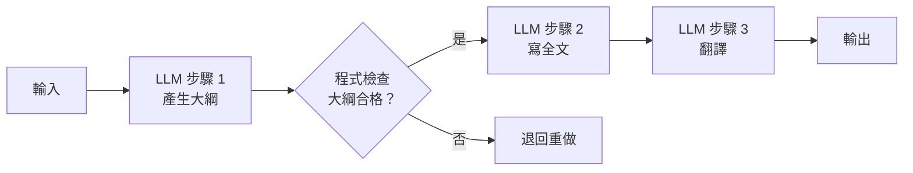

**何時用**：任務能清楚切成固定子步驟。用延遲換取準確度。

### 5.2 Routing（路由）

先分類輸入，再送到專門處理的分支。

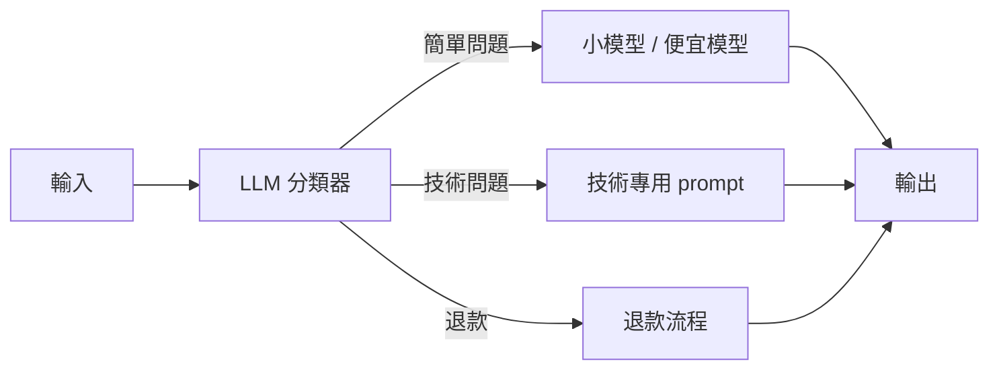

**何時用**：輸入種類差異大，混在一起處理反而互相干擾。也用於成本優化（簡單問題給便宜模型）。

### 5.3 Parallelization（平行化）

同時跑多個 LLM 呼叫，再把結果合併。兩種變體：**分段（sectioning）** 把獨立子任務平行跑；**投票（voting）** 同一任務跑多次取共識。

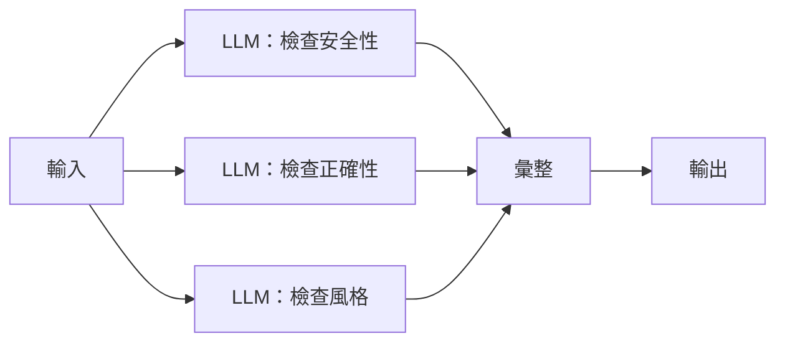

**何時用**：子任務彼此獨立，或需要多個觀點提高信心。

### 5.4 Orchestrator-Workers（指揮者與工人）

一個中央 LLM 動態拆解任務、派給工人 LLM、最後整合。與平行化的差別是：**子任務不是事先定好的**，由指揮者看情況決定。

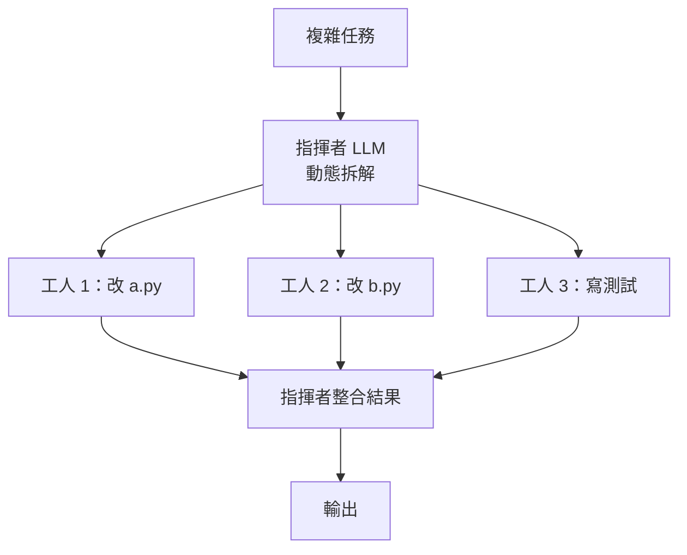

**何時用**：跨多檔案的程式修改、需要多來源的研究任務。

### 5.5 Evaluator-Optimizer（評估者與優化者）

一個 LLM 產生答案，另一個 LLM 評分給回饋，來回迭代直到合格。

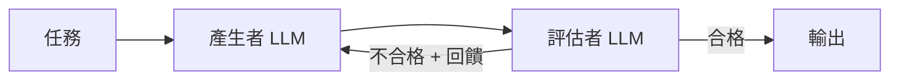

**何時用**：有明確的評估標準，而且回饋真的能讓輸出變好（例如翻譯潤稿、程式碼審查）。

### 5.6 Autonomous Agent（自主代理）

就是第 3 節的迴圈。模型自己規劃、自己呼叫工具、從環境取得「真實回饋」（工具結果、程式執行輸出），必要時在檢查點暫停請人類確認。

**何時用**：問題開放、步數無法預測、而且你信任模型的判斷。例如：「把這份設計文件做成一個 PR」。

---

## 6. 工具設計是成敗關鍵（ACI）

Anthropic 特別強調 **ACI（Agent-Computer Interface，代理與電腦的介面）**，意思是：你花多少心力設計給人用的 UI，就該花同樣心力設計給模型用的工具。

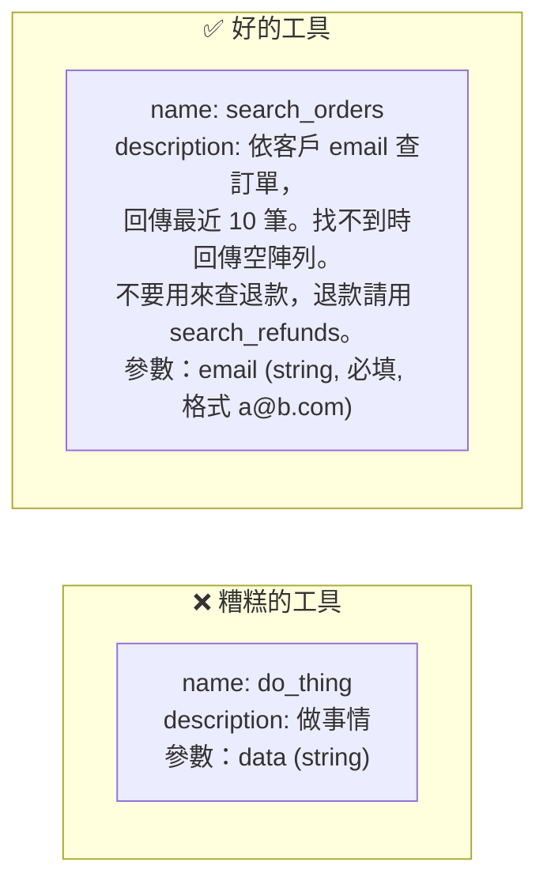

實務原則：

1. **描述要寫給「新進工程師」看**：用途、範例、邊界條件、什麼時候不該用、跟相似工具的差別。
2. **選模型容易產生的格式**：避免要求精確的行數、複雜的字串跳脫；Markdown 比 JSON 容易，JSON 比 XML 容易。
3. **防呆（poka-yoke）**：改參數設計讓錯誤「做不出來」。Anthropic 在 SWE-bench 的例子：要求檔案路徑一律用絕對路徑，代理切換目錄後的錯誤就消失了。
4. **多測試**：用幾十個真實輸入跑過，看模型哪裡用錯，改描述再測。
5. **工具數量要節制**：工具太多、名稱相似，模型會選錯。可以把工具分組、依情境載入。

---

## 7. 安全與可靠性

代理會「自己做事」，所以失控的代價比聊天機器人高得多。幾道必備的防線：

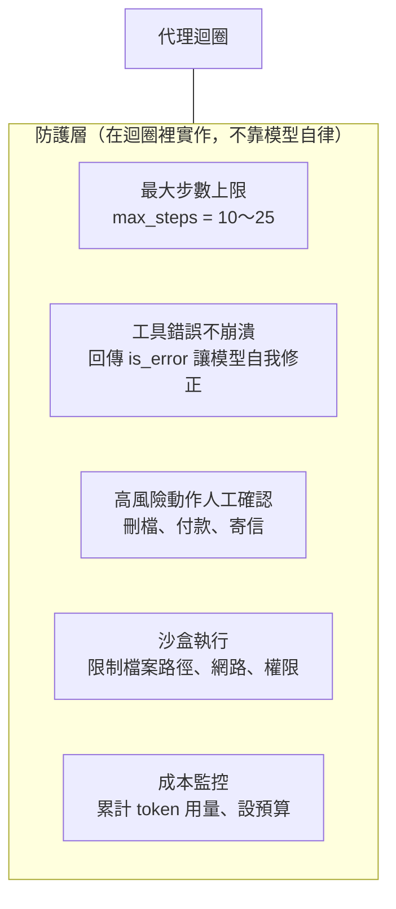

| 風險 | 防線 |
|---|---|
| 無限迴圈、燒光預算 | `max_steps` 上限；累計 `usage.output_tokens` |
| 工具拋出例外讓程式當掉 | `try/except` 包住工具，回傳 `tool_result` 並標記 `is_error: true`，模型會自己換方法 |
| 執行危險動作 | 高風險工具內部先詢問人類（human-in-the-loop），或只回傳「需要確認」 |
| 讀寫不該碰的檔案 | 工具內檢查路徑必須在允許目錄內；用 `ast` 安全求值而非 `eval` |
| 錯誤累積 | 讓模型取得「真實回饋」（跑測試、看輸出），而不是靠它自己猜 |
| 提示注入（prompt injection） | 工具回傳的內容（網頁、檔案）是**資料**不是**指令**，在 system prompt 裡講清楚，重要動作仍要人類確認 |

---

## 8. 多代理與進階主題

### 多代理（Multi-agent）

當一個代理的 context window 塞不下所有資料，或任務可以分頭進行時，可以讓「主代理」派工給多個「子代理」。Anthropic 的研究系統就是一個主代理同時指揮多個子代理各自研究子問題，再彙整。代價是 token 用量大幅增加、延遲變長、除錯更困難。

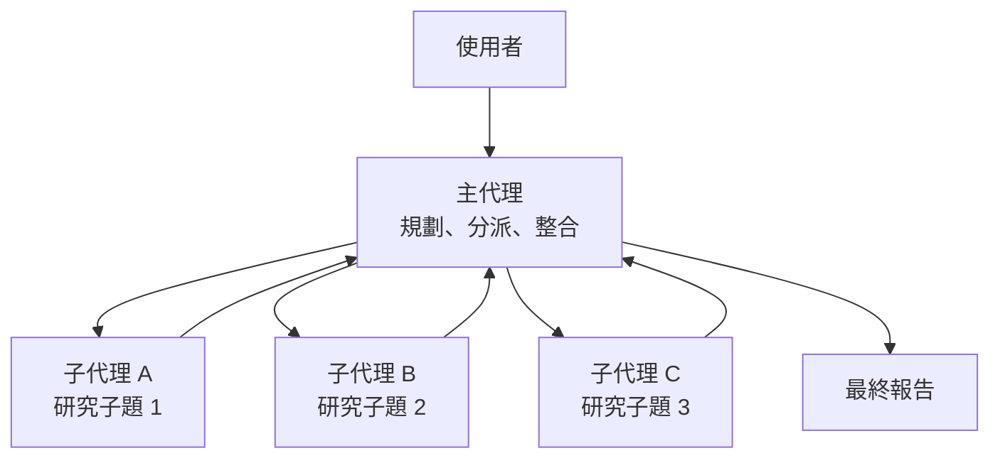

### MCP（Model Context Protocol）

MCP 是一個開放標準，讓工具以統一格式「掛」到任何支援 MCP 的代理上，不用每個代理重寫一次整合。可以想成工具的 USB 介面。

### 記憶的三種層次

| 層次 | 存放位置 | 生命週期 |
|---|---|---|
| 工作記憶 | context window 裡的 messages | 這一次對話 |
| 情節記憶 | 檔案、資料庫（例如 `memory.json`） | 跨對話 |
| 語意記憶 | 向量資料庫（RAG） | 長期知識庫 |

### 什麼時候「不要」做代理

Anthropic 的四個檢查點，有任何一個答「否」就退回更簡單的方案：

1. **複雜度**：任務真的多步驟、無法事先寫死流程嗎？
2. **價值**：成果值得多出的成本與延遲嗎？
3. **可行性**：模型真的擅長這類任務嗎？
4. **錯誤代價**：出錯能被發現並回復嗎（測試、審查、還原）？

---

## 9. 參考資料

- Anthropic, *Building Effective Agents*：<https://www.anthropic.com/engineering/building-effective-agents>
- Yao et al., *ReAct: Synergizing Reasoning and Acting in Language Models* (2022)：<https://arxiv.org/abs/2210.03629>
- Anthropic, Tool use 官方文件：<https://docs.anthropic.com/en/docs/agents-and-tools/tool-use/overview>
- Model Context Protocol：<https://modelcontextprotocol.io/>
- JetBrains, *AI Agent Architecture Explained*：<https://www.jetbrains.com/pages/ai-agents/architecture/ai-agent-architecture/>
- PromptLayer, *How to Build Effective Anthropic Agents*：<https://blog.promptlayer.com/how-to-build-effective-anthropic-agents/>
- AI Builder Club, *How to Build an AI Agent from Scratch in Python (2026)*：<https://www.aibuilderclub.com/blog/how-to-build-ai-agent-from-scratch>
- myengineeringpath.dev, *Build an AI Agent in Python — From Scratch, No Framework (2026)*：<https://myengineeringpath.dev/genai-engineer/build-ai-agent-python/>
- Let's Data Science, *Building AI Agents: ReAct, Planning, Tool Use*：<https://letsdatascience.com/blog/building-ai-agents-react-planning-tool-use>

---

下一篇：[02-自己動手實作代理.md](./02-自己動手實作代理.md) 會帶你用不到 200 行 Python 做出一個能用工具的代理。
