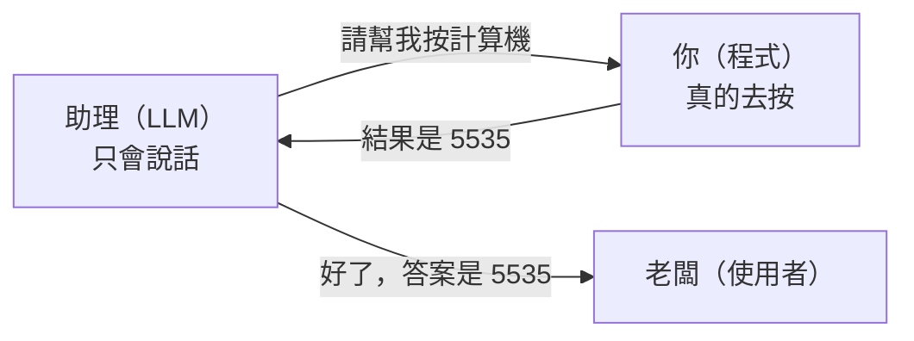
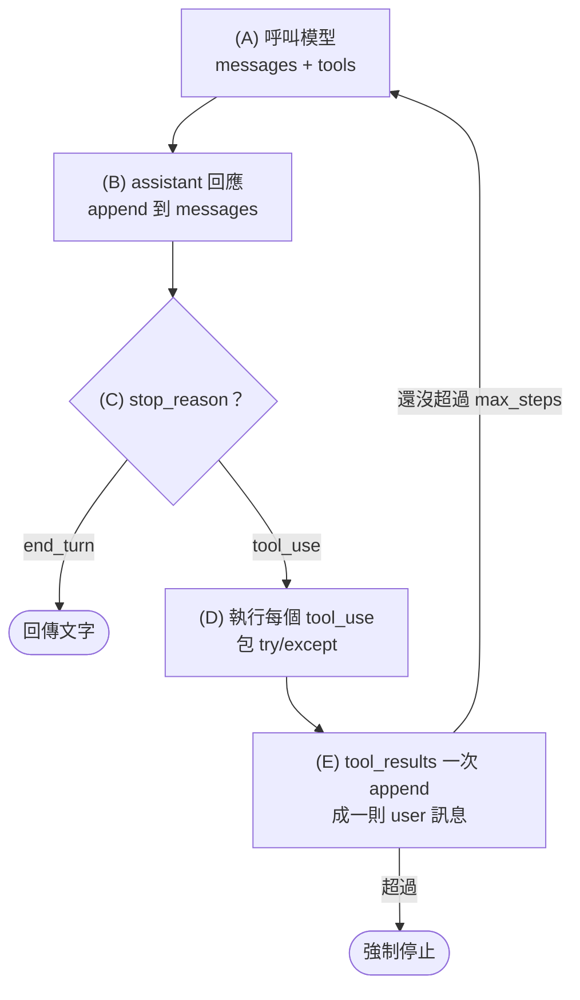
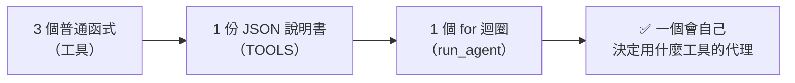

# 自己動手實作一個 AI 代理（Python 版）

> 目標：不用任何框架，只靠 `anthropic` SDK 和一個 `while` 迴圈，做出一個會自己決定「要不要查時間、要不要算數、要不要讀檔」的代理。完整程式在 [agent/simple_agent.py](./agent/simple_agent.py)，不到 200 行。
>
> 如果還沒看過原理，建議先讀 [01-AI代理運作原理.md](./01-AI代理運作原理.md) 的第 3、4 節。

---

## 用一個比喻開始

想像你請了一位**很聰明但手腳被綁住**的助理。

- 他讀過全世界的書（這是 LLM）。
- 但他不能自己打電話、不能自己按計算機、不能自己翻檔案櫃。
- 他只能對你說：「請幫我按計算機，算 123 乘 45」。
- 你（程式）聽到之後去按，把結果「5535」唸給他聽。
- 他再想一想，可能再請你做下一件事，或是宣布「好了，答案是 5535」。

**你和助理之間這個「他說、你做、你回報、他再說」的循環，就是代理迴圈。** 整份教學要做的事，就是把「你」寫成程式。



---

## 準備環境

需要 Python 3.10 以上。

```bash
pip install anthropic
```

設定 API 金鑰（擇一）：

```bash
# Windows PowerShell
$env:ANTHROPIC_API_KEY = "sk-ant-..."

# macOS / Linux
export ANTHROPIC_API_KEY="sk-ant-..."
```

或是安裝 Anthropic CLI 後執行 `ant auth login`，SDK 會自動讀取登入資訊，不用設環境變數。

---

## 第 1 步：先讓模型回一句話

先確認 API 能通。這還不是代理，只是一次呼叫。

```python
import anthropic

client = anthropic.Anthropic()  # 會自動讀取環境變數 ANTHROPIC_API_KEY

response = client.messages.create(
    model="claude-opus-5-5",
    max_tokens=1024,
    messages=[{"role": "user", "content": "用一句話介紹你自己"}],
)
print(response.content[0].text)
```

看到模型回話就代表環境 OK。

---

## 第 2 步：寫一個普通的 Python 函式當「工具」

工具就是普通函式，沒有任何魔法。我們寫三個：

```python
import ast
import datetime
import operator
from pathlib import Path


def get_current_time() -> str:
    """回傳現在的本地日期時間。"""
    return datetime.datetime.now().strftime("%Y-%m-%d %H:%M:%S")


_SAFE_OPS = {
    ast.Add: operator.add,
    ast.Sub: operator.sub,
    ast.Mult: operator.mul,
    ast.Div: operator.truediv,
    ast.Pow: operator.pow,
    ast.Mod: operator.mod,
    ast.USub: operator.neg,
}


def calculate(expression: str) -> str:
    """安全地計算四則運算式（不使用 eval，避免執行任意程式碼）。"""

    def _eval(node):
        if isinstance(node, ast.Constant) and isinstance(node.value, (int, float)):
            return node.value
        if isinstance(node, ast.BinOp) and type(node.op) in _SAFE_OPS:
            return _SAFE_OPS[type(node.op)](_eval(node.left), _eval(node.right))
        if isinstance(node, ast.UnaryOp) and type(node.op) in _SAFE_OPS:
            return _SAFE_OPS[type(node.op)](_eval(node.operand))
        raise ValueError(f"不支援的運算：{ast.dump(node)}")

    tree = ast.parse(expression, mode="eval")
    return str(_eval(tree.body))


WORKDIR = Path.cwd().resolve()


def read_text_file(path: str) -> str:
    """讀取工作目錄內的文字檔（最多 4000 字），禁止讀取目錄外的檔案。"""
    target = (WORKDIR / path).resolve()
    if WORKDIR not in target.parents and target != WORKDIR:
        raise PermissionError(f"只能讀取 {WORKDIR} 底下的檔案")
    return target.read_text(encoding="utf-8")[:4000]
```

兩個安全重點：

- `calculate` 用 `ast` 逐節點檢查，**不用 `eval()`**。模型是會被誘導的，`eval("__import__('os').system('rm -rf /')")` 這種事情必須做不到。
- `read_text_file` 檢查路徑必須在工作目錄內，模型就算被網頁內容慫恿去讀 `C:\Windows\...` 也讀不到。

然後做一張「名稱 → 函式」的對照表，迴圈等一下靠它找工具：

```python
TOOL_FUNCS = {
    "get_current_time": get_current_time,
    "calculate": calculate,
    "read_text_file": read_text_file,
}
```

---

## 第 3 步：告訴模型「有哪些工具、怎麼用」

模型看不到你的 Python 程式碼。它只看得到你用 JSON Schema 寫的**工具說明書**。這份說明書寫得好不好，直接決定模型會不會用錯工具。

```python
TOOLS = [
    {
        "name": "get_current_time",
        "description": "取得現在的本地日期與時間。當使用者問『現在幾點』『今天幾號』時使用。不需要任何參數。",
        "input_schema": {"type": "object", "properties": {}, "required": []},
    },
    {
        "name": "calculate",
        "description": (
            "計算一個數學運算式並回傳結果。支援 + - * / ** % 與括號，"
            "例如 '(12 + 8) * 3'。凡是需要算數的時候都用這個工具，不要自己心算。"
        ),
        "input_schema": {
            "type": "object",
            "properties": {
                "expression": {
                    "type": "string",
                    "description": "要計算的運算式，只能含數字、運算子與括號",
                }
            },
            "required": ["expression"],
        },
    },
    {
        "name": "read_text_file",
        "description": "讀取目前工作目錄內的文字檔內容。path 請用相對路徑，例如 'notes.txt'。",
        "input_schema": {
            "type": "object",
            "properties": {
                "path": {"type": "string", "description": "相對於工作目錄的檔案路徑"}
            },
            "required": ["path"],
        },
    },
]
```

每個工具三個欄位：

| 欄位 | 作用 | 寫作要訣 |
|---|---|---|
| `name` | 模型呼叫時會用的名字 | 要跟 `TOOL_FUNCS` 的 key 一樣 |
| `description` | 模型決定「什麼時候該用」的唯一依據 | 寫用途、範例、什麼時候**不要**用 |
| `input_schema` | 參數的 JSON Schema | 每個參數都加 `description` |

> 注意 `calculate` 的描述刻意寫了「不要自己心算」。沒有這句，模型常常會直接心算，就看不到工具被呼叫了。這就是原理篇說的「工具設計 = 提示工程」。

再補一段 system prompt，告訴模型整體角色：

```python
SYSTEM_PROMPT = (
    "你是一個樂於助人的助理。需要取得時間、算數或讀檔時，請使用提供的工具，"
    "不要猜測。完成後用繁體中文簡短回答使用者。"
)
```

---

## 第 4 步：寫迴圈（代理的心臟）

這是整份教學最重要的 40 行。先看整體，再逐段解釋。

```python
MODEL = "claude-opus-5-5"
MAX_STEPS = 10


def run_agent(user_message: str, max_steps: int = MAX_STEPS) -> str:
    messages = [{"role": "user", "content": user_message}]

    for step in range(1, max_steps + 1):
        # (A) 呼叫模型，附上目前所有對話 + 工具說明書
        response = client.messages.create(
            model=MODEL,
            max_tokens=4096,
            system=SYSTEM_PROMPT,
            tools=TOOLS,
            messages=messages,
        )

        # (B) 模型這一輪說的話原封不動放回對話紀錄
        messages.append({"role": "assistant", "content": response.content})

        # (C) 看 stop_reason 決定下一步
        if response.stop_reason == "end_turn":
            return "".join(b.text for b in response.content if b.type == "text")

        if response.stop_reason == "refusal":
            return "（模型基於安全政策拒絕了這個請求）"

        if response.stop_reason == "max_tokens":
            return "（回答太長被截斷，請提高 max_tokens 或縮小問題）"

        if response.stop_reason != "tool_use":
            return f"（未預期的停止原因：{response.stop_reason}）"

        # (D) 模型想用工具：逐一執行，收集結果
        tool_results = []
        for block in response.content:
            if block.type != "tool_use":
                continue
            print(f"  [step {step}] 🔧 呼叫工具 {block.name}({block.input})")
            try:
                output = TOOL_FUNCS[block.name](**block.input)
                tool_results.append(
                    {"type": "tool_result", "tool_use_id": block.id, "content": str(output)}
                )
            except Exception as exc:
                tool_results.append(
                    {
                        "type": "tool_result",
                        "tool_use_id": block.id,
                        "content": f"工具執行失敗：{exc}",
                        "is_error": True,
                    }
                )

        # (E) 所有工具結果放在同一則 user 訊息，回到 (A)
        messages.append({"role": "user", "content": tool_results})

    return f"（已達 {max_steps} 步上限，代理停止）"
```

### 逐段解釋



**(A) 呼叫模型**
每一輪都把「到目前為止的全部對話」送過去。模型沒有記憶，它的記憶就是這個 `messages` 陣列。

**(B) 把回應放回去**
`response.content` 是一個 list，裡面可能同時有 `text` 區塊和 `tool_use` 區塊。一定要**整個 list**放回去，不能只抓文字。少了 `tool_use` 區塊，下一步的 `tool_result` 就對不上，API 會報錯。

**(C) 看 stop_reason**
這是方向盤。`end_turn` 表示模型講完了，直接回傳。`tool_use` 表示它想用工具，往下走。其他情況（被截斷、被拒絕）就提前結束，不要傻傻繼續。

**(D) 執行工具**
`block.name` 是工具名，`block.input` 是模型填好的參數（已經是 dict）。用 `TOOL_FUNCS[block.name](**block.input)` 一行就能呼叫。包在 `try/except` 裡的原因：工具出錯時**不要讓程式當掉**，而是把錯誤訊息當成 `tool_result` 回給模型，並標記 `is_error: True`。模型看到錯誤會自己換方法（例如改參數再試一次）。

**(E) 回傳結果**
模型可能一輪就要求兩個工具（例如同時查時間和算數）。所有 `tool_result` 必須放在**同一則** user 訊息裡。每個結果的 `tool_use_id` 要對上 `block.id`。

**for 迴圈本身就是安全網**
用 `for step in range(max_steps)` 而不是 `while True`，模型如果一直繞圈，最多跑 10 輪就會停。這是最便宜也最重要的防線。

---

## 第 5 步：加上執行入口

```python
import sys

if __name__ == "__main__":
    question = " ".join(sys.argv[1:]) or "現在幾點？然後幫我算 123 * 45"
    print(f"👤 使用者：{question}")
    answer = run_agent(question)
    print(f"🤖 代理：{answer}")
```

---

## 完整程式與執行

把上面所有片段組起來就是 [agent/simple_agent.py](./agent/simple_agent.py)。執行：

```bash
cd agent
python simple_agent.py "現在幾點？然後幫我算 123 * 45"
```

預期會看到類似這樣的輸出（時間與模型措辭會不同）：

```
👤 使用者：現在幾點？然後幫我算 123 * 45
  [step 1] 🔧 呼叫工具 get_current_time({})
  [step 1] 🔧 呼叫工具 calculate({'expression': '123 * 45'})
🤖 代理：現在是 2026-10-13 14:30:00，123 × 45 = 5535。
```

注意 step 1 同時出現兩個工具呼叫。這就是「平行工具呼叫」，模型判斷兩件事互不相關，一次全要。如果你把兩個 `tool_result` 拆成兩則訊息回傳，程式雖然不會報錯，但模型以後就傾向一次只呼叫一個工具，效率變差。

再試一個會觸發錯誤處理的：

```bash
python simple_agent.py "幫我讀 ../../secret.txt 的內容"
```

`read_text_file` 會丟出 `PermissionError`，迴圈把它包成 `is_error` 回給模型，模型會告訴你它無法讀取目錄外的檔案，而不是程式崩潰。

---

## 延伸練習

做完基本版之後，可以逐一加上這些功能，每一個都只要改幾行：

### 1. 讓它記住跨次對話的事（長期記憶）

加兩個工具 `save_note(key, text)` 和 `load_notes()`，把內容存進 `memory.json`。下次啟動時模型就能「想起來」。

### 2. 高風險動作先問人（Human-in-the-loop）

假設你加了一個 `delete_file` 工具，在函式裡先問：

```python
def delete_file(path: str) -> str:
    if input(f"⚠️ 模型想刪除 {path}，允許嗎？(y/N) ").lower() != "y":
        return "使用者拒絕刪除"
    ...
```

拒絕時回傳文字而非丟例外，模型會優雅地改變計畫。

### 3. 做成可以連續對話的聊天

把 `messages` 搬到函式外面，每次使用者輸入就 append 一則 user 訊息再跑迴圈。對話紀錄會一直累積。

### 4. 用 SDK 內建的 tool runner 省掉手寫迴圈

學會原理之後，正式專案可以讓 SDK 幫你跑迴圈：

```python
from anthropic import beta_tool

@beta_tool
def calculate(expression: str) -> str:
    """計算一個數學運算式並回傳結果。"""
    ...

runner = client.beta.messages.tool_runner(
    model="claude-opus-5-5",
    max_tokens=4096,
    tools=[calculate],
    messages=[{"role": "user", "content": "算 123*45"}],
)
for message in runner:
    pass
```

`@beta_tool` 會從函式簽名與 docstring 自動產生 `input_schema`。但建議先手寫一次迴圈，之後遇到問題才知道框架底下發生什麼事。

### 5. 加上成本監控

每次 `response.usage.input_tokens` 和 `output_tokens` 累加起來，超過預算就提前結束。

---

## 常見錯誤排查

| 症狀 | 原因 | 解法 |
|---|---|---|
| `400 ... tool_use ids were found without tool_result blocks` | 模型要求工具但你沒回 `tool_result`，或 `tool_use_id` 對不上 | 每個 `tool_use` 都要有對應的 `tool_result`，id 用 `block.id` |
| `400 ... unexpected tool_use_id` | assistant 訊息只放了文字，`tool_use` 區塊被丟掉 | `messages.append({"role": "assistant", "content": response.content})` 放整個 list |
| 模型不用工具，直接心算 | 工具描述太弱 | 在 description 寫「需要算數時一律用此工具」 |
| 程式跑了很久沒停 | 沒有 `max_steps`，或工具一直失敗模型一直重試 | 用 `for` 迴圈設上限；檢查工具是否每次都回 `is_error` |
| `AuthenticationError` | 金鑰沒設或設錯 | 確認 `ANTHROPIC_API_KEY` 環境變數，或執行 `ant auth login` |
| 模型只呼叫一個工具，不平行 | 之前把多個 `tool_result` 拆成多則訊息 | 全部放同一則 user 訊息 |
| `400 tool_choice type "any" not supported` | 新模型不支援強制呼叫工具 | 用預設的 `auto`，在 prompt 裡要求使用工具 |

---

## 回顧：你剛剛做了什麼



- 工具是普通函式，模型看不到程式碼，只看得到說明書。
- 迴圈的核心是 `stop_reason`：`tool_use` 就執行再問一次，`end_turn` 就結束。
- 安全來自迴圈這一層：步數上限、錯誤包裝、路徑檢查、人工確認。

所有框架（LangChain、CrewAI、Claude Agent SDK）底下都是這個迴圈。理解它之後，你就有能力判斷什麼時候需要框架，什麼時候 60 行程式就夠了。
